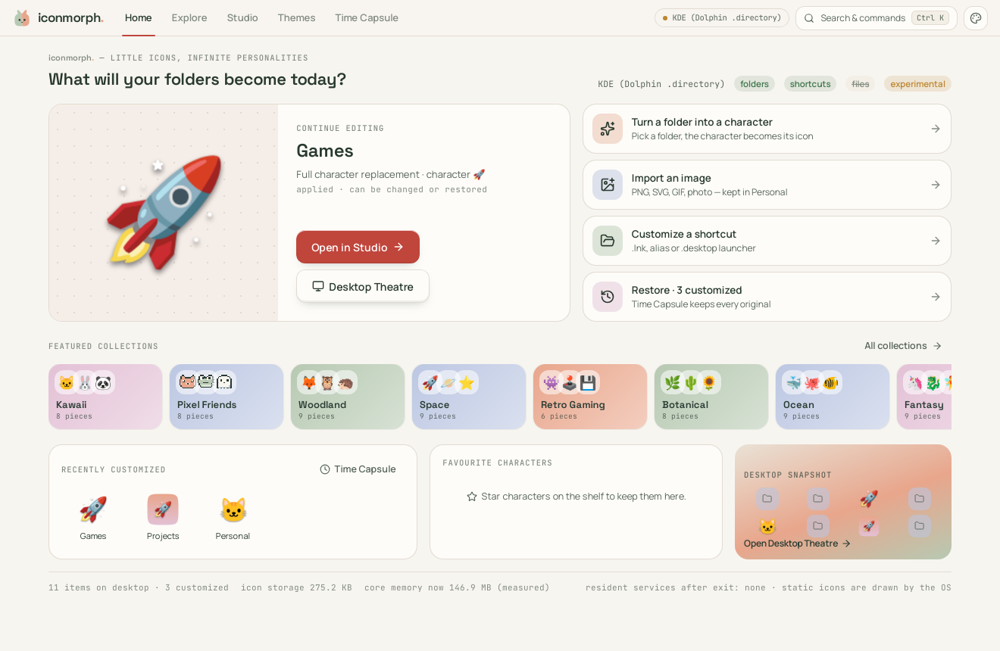
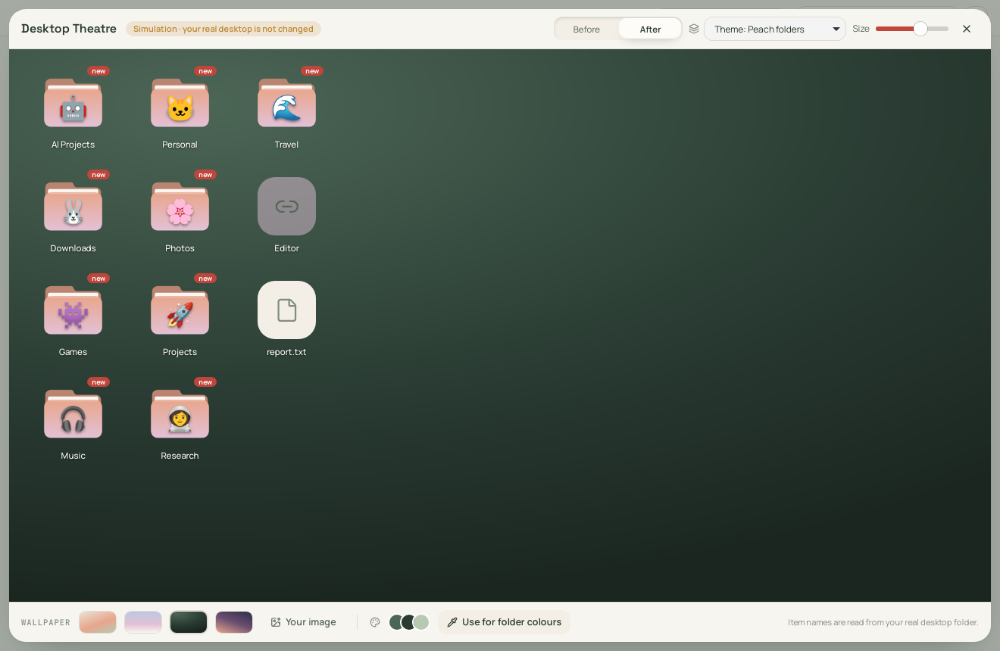
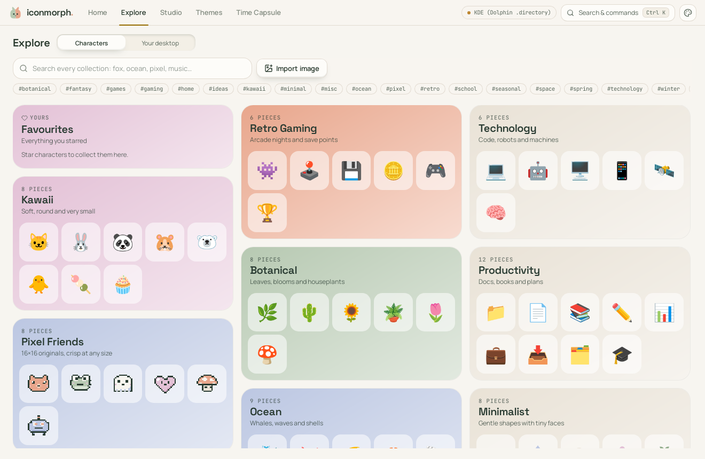
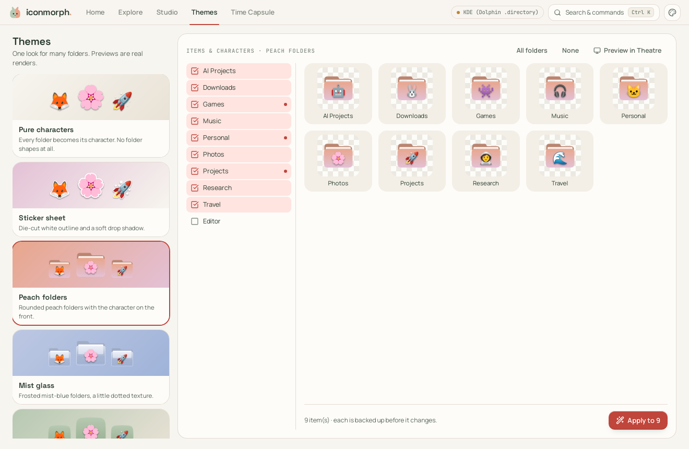
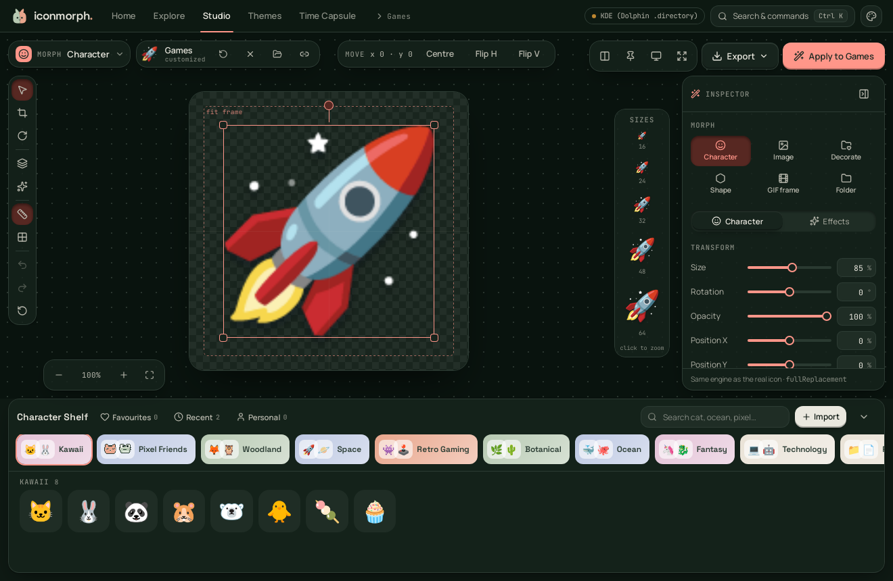
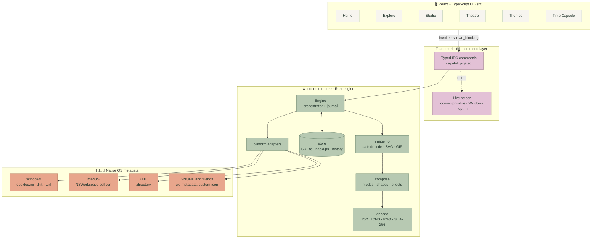
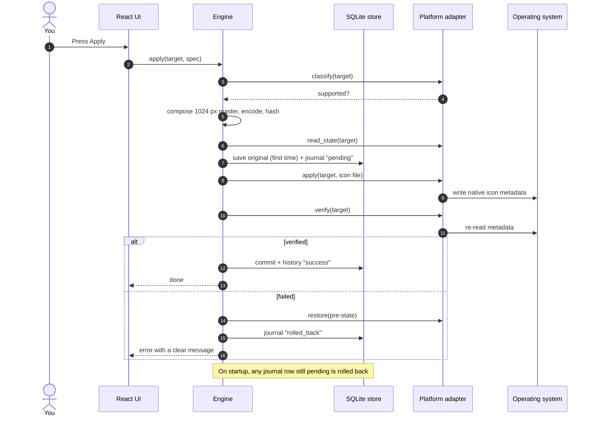
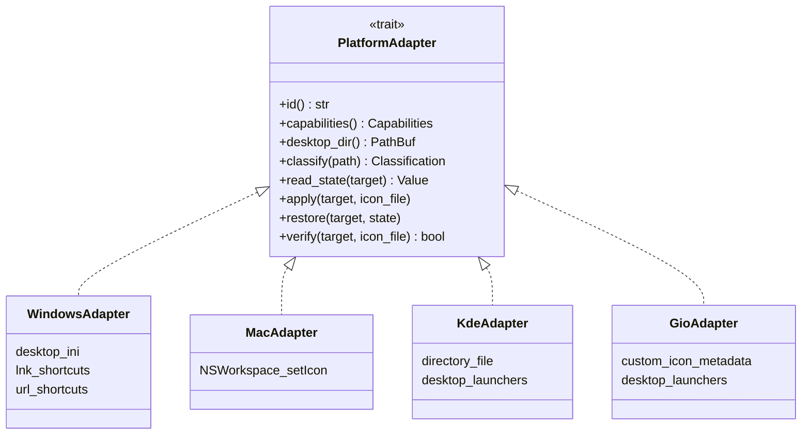

<div align="center">


<a href="https://loganthp.github.io/IconMorph">
  
</a>

<br/>


<br/>


<br/>


<br/><br/>

[**🌐 Landing Page**](https://loganthp.github.io/IconMorph) &nbsp;·&nbsp;
[**📦 Install**](#-install) &nbsp;·&nbsp;
[**⚡ Quick Start**](#-quick-start) &nbsp;·&nbsp;
[**✨ Features**](#-features) &nbsp;·&nbsp;
[**🏗️ Architecture**](#️-architecture) &nbsp;·&nbsp;
[**🛠️ Troubleshooting**](#️-troubleshooting)

</div>


## 🎨 About

**iconmorph** turns real folders and shortcuts into characters, pixel friends, GIF frames and your own images. The icon is written through the operating system's own custom-icon mechanism, so **you can close iconmorph completely and the icon stays**. Nothing runs in the background for static icons.

<div align="center">
  
</div>

<br/>

<div align="center">
  
</div>


## ✨ Features

<table>
<tr>
<td width="33%" valign="top">

### 🎡 Morph Wheel
Six ways to morph an item: **Character**, **Image**, **Decorate**, **Shape**, **GIF frame** and **Original folder**. Pick a mode with the mouse or press `M`, then `1`–`6`.

</td>
<td width="33%" valign="top">

### 🖌️ Canvas-first Studio
Zoom, pan, drag to move / scale / rotate, snapping and guides, undo/redo and a contextual inspector that shows only what the current morph needs.

</td>
<td width="33%" valign="top">

### 🧸 Character Shelf
**My shelf** (your emoji, uploads and pins) plus 12 collections: Kawaii, Pixel Friends, Woodland, Space, Retro Gaming, Botanical, Ocean, Fantasy, Technology, Productivity, Minimalist and Seasonal.

</td>
</tr>
<tr>
<td valign="top">

### 🔍 Morph Reveal
Slider, side-by-side or toggle comparison against the plain folder, the applied icon or a pinned design, plus a **native-size filmstrip** (16–64 px at 1:1) with a loupe.

</td>
<td valign="top">

### 🎭 Desktop Theatre
A full-window simulation of your desktop with your real item names and wallpaper. Press `T`. Nothing is written until you apply.

</td>
<td valign="top">

### 🗂️ Themes
One look for many folders, with a character suggested from each folder's name. Batch apply with progress and cancel.

</td>
</tr>
<tr>
<td valign="top">

### ⏳ Time Capsule
Every original is kept. Step back through an item's earlier designs, restore several at once, or take **desktop snapshots** to return to.

</td>
<td valign="top">

### 🌈 Your look
Warm Studio, Sakura, Botanical, Coastal, Nordic, Midnight, Monochrome or System, plus **Chameleon** accents that adapt to the selected character.

</td>
<td valign="top">

### 🎞️ Live GIF icons <sub>(Windows, opt-in)</sub>
Play a whole GIF on a desktop icon with the small **iconmorph Live** helper. It has a tray icon, exits by itself, and never changes your files.

</td>
</tr>
</table>

Also: ICO / ICNS / PNG export, a command palette (`Ctrl K`), keyboard shortcuts throughout, and reduced-motion / reduced-effects awareness.

### 🎡 The six morphs

| Morph | Result |
| :--- | :--- |
| **Character** | The folder graphic disappears; the character *is* the icon. Double-click still opens the folder |
| **Image** | Your PNG, SVG, JPEG, WebP or photo as the icon (kept in *Personal*, referenced in place) |
| **Decorate** | The folder shape with the character on its front |
| **Shape** | Character on a squircle, rounded square, circle, hexagon or capsule tile |
| **GIF frame** | Scrub a GIF and pick a frame for the still icon. On Windows, optionally animate the whole GIF on the desktop |
| **Original folder** | A restyled folder: classic, rounded or minimal; flat, gradient or glass; dots, stripes, grid or grain |

### 🖼️ Gallery

<table>
<tr>
<td align="center"><br/><sub><b>Home</b></sub></td>
<td align="center"><br/><sub><b>Desktop Theatre</b></sub></td>
</tr>
<tr>
<td align="center"><br/><sub><b>Explore</b></sub></td>
<td align="center"><br/><sub><b>Time Capsule</b></sub></td>
</tr>
<tr>
<td align="center"><br/><sub><b>Themes</b></sub></td>
<td align="center"><br/><sub><b>Studio in Midnight</b></sub></td>
</tr>
</table>


## 🏗️ Architecture

iconmorph is a thin **Tauri 2** shell around a **Rust engine**. The React UI never draws icons itself: every preview comes from the same engine path that writes the real icon, so what you see is what gets applied.



### 🔄 Every change is a transaction

Applying an icon follows **Validate → Generate → Backup → Apply → Verify → Commit**. The original metadata is saved before the first change. Failures roll back, and a crash mid-change is undone the next time iconmorph starts.



### 🔌 One adapter per desktop

Adding a desktop environment means adding one adapter. No image code is duplicated.



Read more in [docs/ARCHITECTURE.md](docs/ARCHITECTURE.md).


## 🧰 Tech Stack

| Layer | Technology | Why it is here |
| :--- | :--- | :--- |
| **Desktop shell** |  | Small native app with a typed, capability-gated IPC |
| **Engine** |  `image` · `resvg` · `ico` · `icns` | Safe image decoding, SVG rendering, ICO / ICNS / PNG encoding |
| **Storage** |  `rusqlite` (bundled) | Backups, operation journal, history, snapshots, settings |
| **Windows APIs** | `windows` crate | Shell API for `desktop.ini`, `IShellLinkW` for `.lnk`, desktop host for Live GIFs |
| **macOS APIs** | `objc2` · `objc2-app-kit` | `NSWorkspace setIcon:forFile:` |
| **UI** |   | Typed front end |
| **Build** |  | Dev server on port 1420 and production bundle |
| **Styling** |  `culori` | OKLCH themes and Chameleon accents |
| **Components** | Radix UI · `lucide-react` · `motion` · `@tanstack/react-virtual` | Accessible dialogs, sliders, switches; virtualised character grid |
| **State and validation** | `zustand` · `zod` | App and Studio state; settings and IPC validation |
| **Testing** | Rust tests ·  · Testing Library | Engine on real temp folders, IPC contract, native adapter tests in CI, UI tests |
| **Quality** | ESLint · `rustfmt` · `clippy -D warnings` | Lint and format gates |
| **CI/CD** |  | Checks on Linux, Windows and macOS; releases for 6 targets; landing page deploy |
| **Landing page** | React · Vite · Tailwind · GitHub Pages | [loganthp.github.io/IconMorph](https://loganthp.github.io/IconMorph) |


## 📁 Project Structure

```text
IconMorph/
├── crates/iconmorph-core/      # Rust engine
│   ├── src/                    #   compose · encode · image_io · store · live · engine
│   │   └── platform/           #   windows · macos · linux · desktop_entry · url_shortcut · windows_live
│   ├── tests/                  #   engine (real temp folders) · ipc_contract · windows_native · macos_native
│   └── examples/               #   render_samples · make_app_icons · bench_engine
├── src-tauri/                  # Thin Tauri 2 shell: IPC commands, capabilities, bundling
├── src/                        # React + TypeScript UI
│   ├── features/               #   home · explore · icon-studio · desktop-theatre · theme-studio · time-capsule
│   ├── lib/                    #   typed IPC · specs · collections · chameleon (OKLCH) · session
│   ├── stores/                 #   zustand stores
│   └── test/                   #   Vitest suites
├── landing/                    # Landing page (React + Vite), deployed to GitHub Pages
├── public/collections/         # Pixel Friends + Minimalist artwork (original, CC0)
├── assets/                     # Brand mark, bundled characters, manifests, README artwork
├── docs/                       # ARCHITECTURE · PLATFORMS · TESTING · screenshots
├── benchmarks/                 # Memory and CPU profiling scripts and results
├── scripts/                    # typecheck-native.sh · gen-collections.py
└── .github/workflows/          # ci.yml · release.yml · pages.yml
```


## 📦 Install

Download an installer from [**Releases**](../../releases). Packaged builds need no Node.js, Rust or developer tools.

| OS | Installer | First launch |
| :--- | :--- | :--- |
| 🪟 **Windows** | `.msi` or `-setup.exe` (x64 and ARM64) | Builds are unsigned, so SmartScreen may warn: choose **More info → Run anyway**. WebView2 is installed automatically if missing |
| 🍎 **macOS** | `.dmg` (Apple Silicon and Intel) | Unsigned builds need **right-click → Open** the first time |
| 🐧 **Linux** | `.AppImage`, `.deb` or `.rpm` (x64 and ARM64) | GIO desktops need the `gio` tool (`libglib2.0-bin` / `glib2`), which most distributions ship |

Verify downloads against `SHA256SUMS.txt` from the release.

> **Prefer building it yourself?** Jump to [Quick Start](#-quick-start).


## ⚡ Quick Start

### ✅ Prerequisites

| Tool | Version | Get it |
| :--- | :--- | :--- |
| **Node.js** | 22 LTS recommended (20.19+ works) | [nodejs.org](https://nodejs.org) |
| **Rust** | stable, 1.89 or newer | [rustup.rs](https://rustup.rs) |
| **Git** | any recent version | [git-scm.com](https://git-scm.com) |
| **Tauri 2 system libraries** | see below | [Tauri prerequisites](https://v2.tauri.app/start/prerequisites/) |

<details>
<summary><b>🪟 Windows</b></summary>

1. Install **Microsoft C++ Build Tools** and tick **Desktop development with C++**.
2. **WebView2** ships with Windows 11. On Windows 10 it is installed on demand.
3. Install Rust with `rustup`, choosing the default MSVC toolchain.

```powershell
winget install OpenJS.NodeJS.LTS
winget install Rustlang.Rustup
rustup update stable
```
</details>

<details>
<summary><b>🍎 macOS</b></summary>

```bash
xcode-select --install
brew install node
curl --proto '=https' --tlsv1.2 -sSf https://sh.rustup.rs | sh
rustup update stable
```
</details>

<details>
<summary><b>🐧 Linux (Debian / Ubuntu)</b></summary>

```bash
sudo apt update
sudo apt install -y libwebkit2gtk-4.1-dev build-essential libxdo-dev libssl-dev \
  libayatana-appindicator3-dev librsvg2-dev libglib2.0-bin
curl --proto '=https' --tlsv1.2 -sSf https://sh.rustup.rs | sh
rustup update stable
```

Install Node.js 22 from [nodejs.org](https://nodejs.org) or with `nvm`.
</details>

Check everything is in place:

```bash
node --version      # v22.x (or 20.19+)
npm --version
rustc --version     # 1.89 or newer
cargo --version
```

### 1️⃣ Clone the repository

```bash
git clone https://github.com/LoganthP/IconMorph.git
cd IconMorph
```

### 2️⃣ Install dependencies

```bash
npm install
```

Rust crates are fetched automatically the first time you run or build the app.

### 3️⃣ Run the app in development mode

```bash
npm run tauri dev
```

This starts the Vite dev server on `http://localhost:1420` and opens the desktop window with hot reload. **The first run compiles the Rust crates, which can take several minutes.** Later runs are fast.

> 💡 Run `npm run dev` on its own only to work on the UI in a browser. Icons can be applied only inside the Tauri window, because the browser has no access to the Rust engine.

### 4️⃣ Build an installer for your OS

```bash
npm run tauri build
```

The installers land in `target/release/bundle/`. The raw binary is at `target/release/iconmorph` (`iconmorph.exe` on Windows).

```bash
npm run tauri build -- --bundles deb     # Linux: only the .deb
npm run tauri build -- --bundles nsis    # Windows: only the setup.exe
npm run tauri build -- --bundles dmg     # macOS: only the .dmg
```

### 5️⃣ Try your first icon

1. Make a test folder with a file inside.
2. Open iconmorph and go to **Explore**, then click your folder.
3. Pick a character from the shelf, for example 🐱.
4. In the Morph Wheel choose **Character** and press **Apply**.
5. Check your desktop or file manager. Close iconmorph: the icon stays.
6. Reopen iconmorph, then **Time Capsule → Restore** to get the original back.

### 🌐 Run the landing page

```bash
cd landing
npm install
npm run dev        # http://localhost:5173
npm run build      # production build in landing/dist
```

Pushes to `main` that touch `landing/` redeploy the page to GitHub Pages through `.github/workflows/pages.yml`.

### 🧪 Run the checks

```bash
# Front end
npm run lint
npm run typecheck
npm run test

# Rust engine
cargo fmt --all --check
cargo clippy --workspace --all-targets -- -D warnings
cargo test --workspace

# Type-check the Windows and macOS adapters from Linux
./scripts/typecheck-native.sh
```

### 🧰 Handy commands

| Command | What it does |
| :--- | :--- |
| `npm run tauri dev` | Run the desktop app with hot reload |
| `npm run tauri build` | Build installers for the current OS |
| `npm run dev` | Vite dev server only (UI in a browser) |
| `npm run build` | Type-check and build the web bundle |
| `npm run lint` | ESLint over `src/` |
| `npm run typecheck` | `tsc --noEmit` |
| `npm run test` | Vitest |
| `cargo test --workspace` | All Rust tests |
| `cargo run -p iconmorph-core --example render_samples -- assets/characters/cat.svg out.png` | Render every mode to a contact sheet |
| `cargo run -p iconmorph-core --example make_app_icons` | Regenerate iconmorph's own app icons with the engine |
| `cargo run -p iconmorph-core --example bench_engine` | Run the engine benchmark |
| `python3 scripts/gen-collections.py` | Regenerate the Pixel Friends and Minimalist SVGs and manifest |


## 🧭 Status: what works where

This is an honest matrix. **Verified** means the full apply → verify → restore cycle was run on that mechanism by automated tests and through the real UI. **Built, not yet run** means the code compiles against the real OS bindings and has native integration tests that run on that OS in CI, but it has not yet been exercised on real hardware by the maintainers.

| | Windows 10 / 11 | macOS 11+ | Linux · KDE Plasma | Linux · GNOME, Cinnamon, MATE, XFCE, Budgie |
| :--- | :--- | :--- | :--- | :--- |
| **Mechanism** | `desktop.ini` via `SHGetSetFolderCustomSettings`; `.lnk` via `IShellLinkW`; `.url` via its `IconFile` key | `NSWorkspace setIcon:forFile:` | Folder `.directory` file | GIO `metadata::custom-icon` (gvfs) |
| **Folders** | 🟡 Built, not yet run | 🟡 Built, not yet run | ✅ **Verified** | 🟡 Built, not yet run on a real session |
| **Shortcuts** | 🟡 `.lnk` and `.url` (Steam, Epic, web apps) | 🟡 Aliases | ✅ `.desktop` **Verified** | ✅ `.desktop` **Verified** |
| **Plain files** | ❌ Not possible (Windows limitation) | 🟡 Built, not yet run | ❌ Not possible (Dolphin limitation) | 🟡 Built, not yet run |
| **Icon written** | Multi-size ICO (16–256) | ICNS (16–1024, @2x) | PNG 512 | PNG 512 |
| **Live GIF on desktop** | 🟡 Opt-in, built, not yet run | ❌ Still frame | ❌ Still frame | ❌ Still frame |

The app shows this information for the machine it is running on (the platform chip in the top bar and the chips on Home) and disables whatever is not supported there. Platform details are in [docs/PLATFORMS.md](docs/PLATFORMS.md).


## 🪶 How it stays lightweight

- **No tray icon, no autostart, no background service, no polling** for static icons. Closing the window ends the process, and its WebView helpers exit within one second.
- Generated icons are stored once, by content hash, in the per-user data folder (never a temp folder), because the OS keeps reading them after iconmorph exits.
- Every change is **Validate → Generate → Backup → Apply → Verify → Commit**, and a crash mid-change is rolled back on the next start.
- Imported images, SVGs and GIFs are sniffed by magic bytes, size-limited and decoded with allocation limits. SVG external references are never resolved.

Measured numbers for a release build are in [benchmarks/README.md](benchmarks/README.md).

### 🎞️ Animated icons and the "no background process" rule

The app itself never stays running. The one exception is opt-in: if you turn on **Animate on the desktop** for a GIF design (Windows), the separate **iconmorph Live** helper runs while something is animating. It shows a notification-area icon (Pause / Open / Stop), never changes files, and quits by itself when nothing is left to animate. **Start with Windows** is off unless you tick it.

### 📂 Where your data lives

| OS | Data folder |
| :--- | :--- |
| Windows | `%APPDATA%\IconMorph\IconMorph\data` |
| macOS | `~/Library/Application Support/dev.IconMorph.IconMorph` |
| Linux | `$XDG_DATA_HOME/iconmorph` (usually `~/.local/share/iconmorph`) |

Uninstalling the app does not delete this folder, so applied icons keep working. To remove everything, use **Time Capsule → Restore all**, then **Remove unused icons**, then delete the folder.


## 🛠️ Troubleshooting

<details>
<summary><b>❌ <code>npm run tauri dev</code> fails with a Rust or linker error</b></summary>

Check `rustc --version` is 1.89 or newer and run `rustup update stable`. On Windows, make sure **Desktop development with C++** is installed. On Linux, install the packages from the prerequisites above.
</details>

<details>
<summary><b>❌ Port 1420 is already in use</b></summary>

The dev server uses a fixed port (`strictPort`). Stop whatever is using port 1420 and run the command again.
</details>

<details>
<summary><b>⏳ The first build takes a long time</b></summary>

That is normal. The first build compiles every Rust dependency, including the SQLite and image libraries. Later builds reuse the cache.
</details>

<details>
<summary><b>🛡️ Windows SmartScreen or macOS Gatekeeper blocks the installer</b></summary>

Builds are unsigned. On Windows choose **More info → Run anyway**. On macOS right-click the app and choose **Open**.
</details>

<details>
<summary><b>🐧 Linux: the icon does not change on GNOME / XFCE</b></summary>

GIO desktops need the `gio` tool (`libglib2.0-bin`) and the gvfs metadata daemon of a normal desktop session. Launchers (`.desktop`) may need **Allow Launching** again after editing.
</details>

<details>
<summary><b>🪟 A Windows shortcut says it can't be customized</b></summary>

Shortcuts installed for all users live in `C:\Users\Public\Desktop` and need administrator rights to change. iconmorph marks them and explains this. Plain programs (`.exe`, `.jar`) cannot hold their own icon without being modified, so customize their shortcut instead.
</details>

<details>
<summary><b>🎞️ The animated GIF doesn't play on my desktop</b></summary>

Animation works on Windows only, for items on the desktop itself (not inside Explorer folder windows). Check that **Animate on the desktop** was ticked before you pressed Apply and that the iconmorph Live icon is in the notification area. Elsewhere the GIF's chosen frame is the icon.
</details>

### ⚠️ Known limitations

- On Linux WebKitGTK, View Transitions are turned off because they crash the web process (WebKitGTK 2.52). Workspaces cross-fade instead.
- Studio's Layers popover lists the fixed character / folder stack. Free multi-layer editing is on the roadmap.
- A GIF with transparent areas shows the still frame behind those areas.
- Windows and macOS builds compile against the real APIs and have native tests in CI, but have not been run on real hardware by the maintainers yet. Help is welcome: see the [manual test checklist](docs/TESTING.md).


## 🗺️ Roadmap

- [ ] Verify Windows and macOS on real hardware, then flip the matrix entries to *Verified*
- [ ] Show the item's real native icon in Explore and as "Before" in Studio
- [ ] `.iconpack` import / export
- [ ] Save, duplicate, export and import Themes
- [ ] Text overlays and multi-layer editing in Studio
- [ ] CLI: `iconmorph apply <path> --emoji 🐱 --mode full`
- [ ] Context-menu entry in Explorer, Finder and Nautilus
- [ ] WinGet, Scoop, Homebrew and AUR packages

Full list in [ROADMAP.md](ROADMAP.md). Release notes are in [CHANGELOG.md](CHANGELOG.md).

## 🤝 Contributing

Issues and pull requests are welcome. Good first areas: platform adapters, icon collections, translations and editor tools.

1. Fork the repo and create a branch.
2. Run the [checks](#-run-the-checks) before opening a pull request.
3. Read [CONTRIBUTING.md](CONTRIBUTING.md), [SECURITY.md](SECURITY.md) and the [Code of Conduct](CODE_OF_CONDUCT.md).

Testing on a real Windows, macOS or Linux machine is one of the most useful contributions. Follow [docs/TESTING.md](docs/TESTING.md) and report the result in an issue.

## 🎭 Characters and licensing

The character library draws emoji with **your system's colour-emoji font** (Segoe UI Emoji, Apple Color Emoji, Noto Color Emoji) at the moment you pick one, so iconmorph redistributes no third-party emoji artwork. Bundled artwork under `assets/` and `public/collections/` is original and listed in `assets/manifests/assets.json`, and each shelf item shows its source and licence. Do not add copyrighted anime, film or game characters. You can import your own images.

## 📄 License

Code is released under the [MIT License](LICENSE). See [THIRD_PARTY_LICENSES.md](THIRD_PARTY_LICENSES.md) for dependencies.

<div align="center">


Made with 🧡 by [**Loganth**](https://github.com/LoganthP)

<sub>If iconmorph gave your desktop some personality, a ⭐ on the repo is much appreciated.</sub>

</div>
