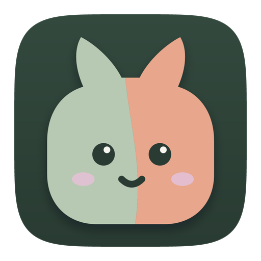
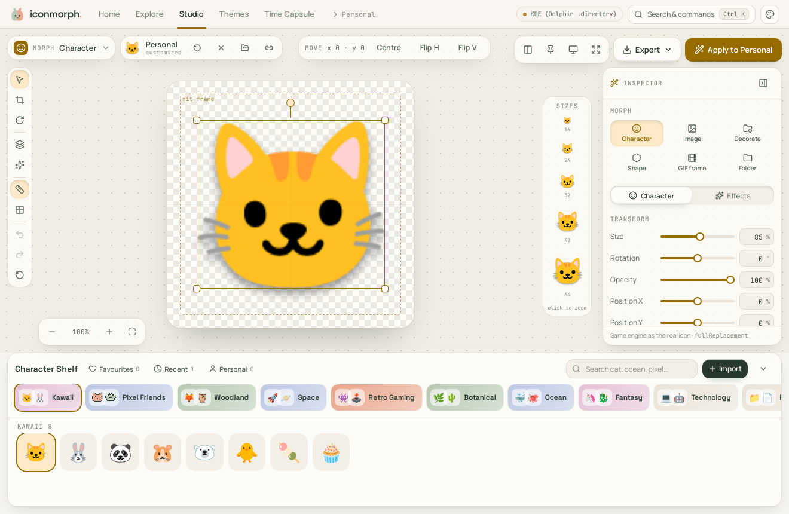
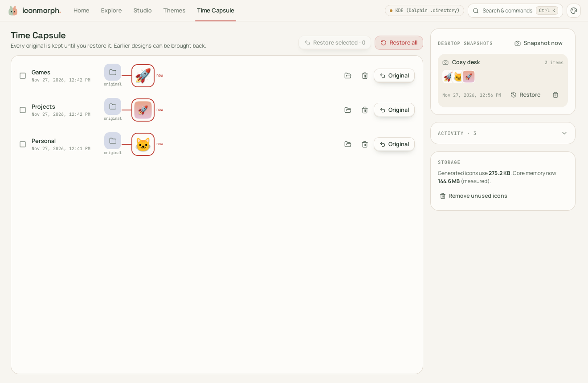

<p align="center"></p>

<h1 align="center">iconmorph.</h1>
<p align="center"><b>Little icons. Infinite personalities.</b></p>
<p align="center"><a href="https://loganthp.github.io/IconMorph">Landing Page</a> · <a href="#install">Install</a> · <a href="#develop">Build from source</a></p>

iconmorph turns real folders and shortcuts into characters, pixel friends, GIF frames and your own images. The icon is written through the operating system's own custom-icon mechanism, so **you can close iconmorph completely and the icon stays**. Nothing runs in the background.



## What it does

Pick a folder, spin the **Morph Wheel**, pick a character from the shelf, press Apply.

| Morph | Result |
|---|---|
| **Character** | The folder graphic disappears; the character *is* the icon. Double-click still opens the folder |
| **Image** | Your PNG, SVG, JPEG, WebP or photo as the icon (kept in *Personal*, referenced in place) |
| **Decorate** | The folder shape with the character on its front |
| **Shape** | Character on a squircle, rounded square, circle, hexagon or capsule tile |
| **GIF frame** | Scrub a GIF and pick a frame for the still icon. On Windows, optionally **animate the whole GIF on the desktop** with the opt-in iconmorph Live helper |
| **Original folder** | A restyled folder: classic, rounded or minimal; flat, gradient or glass; dots, stripes, grid or grain |

Around that:

- **Studio**: a canvas-first editor. Zoom and pan, drag to move / scale / rotate (handles sit on the engine's real layout), snapping and guides, full-screen, undo/redo, and a contextual inspector that only shows what the current morph needs.
- **Character Shelf**: **My shelf** (any emoji you type or paste, your uploads, characters you pin) plus 12 collections (Kawaii, Pixel Friends, Woodland, Space, Retro Gaming, Botanical, Ocean, Fantasy, Technology, Productivity, Minimalist, Seasonal) plus your imports, favourites and recents. Drag a character onto the canvas.
- **Morph Reveal**: slider, side-by-side or toggle comparison with the plain folder, the currently applied icon, or a pinned design. **Native size filmstrip** shows 16–64 px at 1:1 device pixels, with a loupe up to 256.
- **Desktop Theatre** (T): a full-window simulation of your desktop with your real item names, your wallpaper or a preset, before/after and theme previews. Labelled as a simulation; nothing is written until you apply.
- **Themes**: one look for many folders, with a character suggested from each folder's name. Batch apply with progress and cancel.
- **Time Capsule**: every original is kept. Step back through an item's previous designs, restore several at once or everything, and take **desktop snapshots** you can return to.
- **Your look**: Warm Studio, Sakura, Botanical, Coastal, Nordic, Midnight, Monochrome or System, any accent, and **Chameleon** accents that adapt to the selected character (or lock to your theme). Reduced-motion and reduced-effects aware.
- ICO / ICNS / PNG export, command palette (Ctrl K), keyboard shortcuts throughout.

| | |
|---|---|
|  |  |
|  |  |
|  |  |

## Status: what works where

This is an honest matrix. *Verified* means the full apply → verify → restore cycle was run on that mechanism by automated tests and through the real UI. *Built, not yet run* means the code compiles against the real OS bindings and has native integration tests that run on that OS in CI, but it has not yet been exercised on real hardware by the maintainers.

| | Windows 10 / 11 | macOS 11+ | Linux · KDE Plasma | Linux · GNOME, Cinnamon, MATE, XFCE, Budgie |
|---|---|---|---|---|
| Mechanism | `desktop.ini` via `SHGetSetFolderCustomSettings`; `.lnk` via `IShellLinkW`; `.url` via its `IconFile` key | `NSWorkspace setIcon:forFile:` | Folder `.directory` file | GIO `metadata::custom-icon` (gvfs) |
| Folders | Built, not yet run | Built, not yet run | **Verified** | Built, not yet run on a real session |
| Shortcuts | `.lnk` and `.url` (Steam, Epic, web apps): built, not yet run | Aliases: built, not yet run | `.desktop`: **Verified** | `.desktop`: **Verified** |
| Plain files | Not possible (Windows limitation) | Built, not yet run | Not possible (Dolphin limitation) | Built, not yet run |
| Icon format written | Multi-size ICO (16–256) | ICNS (16–1024, @2x) | PNG 512 | PNG 512 |

The app shows this information for the machine it is running on (the platform chip in the top bar and the chips on Home) and disables what is not supported there. Live animated desktop icons are **not** implemented: they would need a permanently running process, which conflicts with the zero-background design. A GIF frame can be applied as a static icon.

## Install

Download an installer from [Releases](../../releases). Packaged builds need no Node.js, Rust or developer tools.

- **Windows**: `.msi` or `-setup.exe`. Development builds are unsigned, so SmartScreen may warn; choose *More info → Run anyway*. WebView2 is installed automatically if missing.
- **macOS**: `.dmg`. Unsigned builds need right-click → *Open* the first time.
- **Linux**: `.AppImage`, `.deb` or `.rpm`. GIO desktops need the `gio` tool (`libglib2.0-bin` / `glib2`), which most distributions ship.

Verify downloads with `SHA256SUMS.txt` from the release.

## How it stays lightweight

- No tray icon, no autostart, no background service, no polling. Closing the window ends the process (verified: the process and its WebView helpers exit within one second).
- Generated icons are stored once, by content hash, in the per-user data folder (never a temp folder), because the OS keeps reading them after IconMorph exits.
- Every change is **Validate → Backup → Generate → Apply → Verify → Commit**. The original metadata is backed up before the first change; failures roll back; a crash mid-change is undone the next time IconMorph starts.

Measured on a 2-vCPU Linux VM (release build), 0.1 → 0.2 redesign: see the before/after table in [benchmarks/README.md](benchmarks/README.md). In both versions: **0 processes after closing**, no idle CPU while the window is open and untouched.

## Animated icons and the "no background process" rule
The app itself never stays running: close it and it's gone. The one exception is opt-in: if you turn on *Animate on the desktop* for a GIF design (Windows), the separate **iconmorph Live** helper runs while something is animating. It shows a notification-area icon (Pause / Open / Stop), never changes files, and quits by itself when nothing is left to animate. *Start with Windows* is off unless you tick it.

## Known limitations
- On Linux WebKitGTK, View Transitions are turned off because they crash the web process (WebKitGTK 2.52); workspaces cross-fade instead.
- Studio's Layers popover lists the fixed character / folder stack; free multi-layer editing is on the roadmap.
- Animated icons play on desktop items only (not inside Explorer folder windows), and only on Windows. Elsewhere the GIF's chosen frame is the icon.
- On Windows, shortcuts installed for all users live in `C:\Users\Public\Desktop` and need administrator rights to change; iconmorph marks them and explains this. Plain programs (`.exe`, `.jar`) cannot hold their own icon on Windows without modifying them, so customize their shortcut instead.
- Windows and macOS builds compile against the real APIs and have native tests in CI, but have not been run on real hardware by the maintainers yet.

## Develop

Prerequisites: Rust (stable, 1.80+), Node.js 20+, and the [Tauri 2 system prerequisites](https://v2.tauri.app/start/prerequisites/) for your OS (WebView2 on Windows; Xcode Command Line Tools on macOS; on Debian/Ubuntu `libwebkit2gtk-4.1-dev build-essential libxdo-dev libssl-dev libayatana-appindicator3-dev librsvg2-dev`).

```bash
npm install
npm run tauri dev          # run the app
npm run tauri build        # installers for this OS
npm run tauri build -- --bundles deb   # e.g. only the .deb on Linux
```

Checks:

```bash
npm run lint && npm run typecheck && npx vitest run
cargo fmt --all --check && cargo clippy --workspace --all-targets -- -D warnings && cargo test --workspace
./scripts/typecheck-native.sh   # type-check the Windows + macOS adapters from Linux
```

Tools: `cargo run -p iconmorph-core --example render_samples -- assets/characters/cat.svg out.png` renders every mode to a contact sheet; `--example make_app_icons` regenerates IconMorph's own app icons with the engine; `--example bench_engine` runs the benchmark. `python3 scripts/gen-collections.py` regenerates the Pixel Friends and Minimalist SVGs and their manifest entries.

## Project layout

```
crates/iconmorph-core/   Rust engine: decoding, composition, ICO/ICNS/PNG, SQLite, adapters, journal
  src/platform/          windows.rs · macos.rs · linux.rs · desktop_entry.rs (lossless .desktop editor)
  tests/                 engine.rs (end-to-end on real temp folders) · ipc_contract.rs · windows_native.rs · macos_native.rs
src-tauri/               Thin Tauri 2 shell: typed IPC commands, capabilities, bundling
src/                     React + TypeScript UI
  features/              home · explore · icon-studio · desktop-theatre · theme-studio · time-capsule
  lib/                   typed IPC, spec defaults, collections, chameleon (OKLCH), session
  assets/fonts/          Space Grotesk, Manrope, JetBrains Mono (OFL)
public/collections/      Pixel Friends + Minimalist (original, CC0)
assets/                  Original bundled artwork + manifests
docs/                    Architecture, platform notes, manual test checklist
```

More: [Architecture](docs/ARCHITECTURE.md) · [Platform notes](docs/PLATFORMS.md) · [Manual native test checklist](docs/TESTING.md) · [Roadmap](ROADMAP.md) · [Security](SECURITY.md) · [Contributing](CONTRIBUTING.md)

## Characters and licensing

The character library draws emoji with **your system's colour-emoji font** (Segoe UI Emoji, Apple Color Emoji, Noto Color Emoji) at the moment you pick one, so IconMorph redistributes no third-party emoji artwork. Bundled artwork under `assets/` and `public/collections/` is original and listed in `assets/manifests/assets.json`. Each shelf item shows its source and licence. Do not add copyrighted anime, film or game characters; users can import their own images.

Code is MIT-licensed; see [LICENSE](LICENSE) and [THIRD_PARTY_LICENSES.md](THIRD_PARTY_LICENSES.md).
